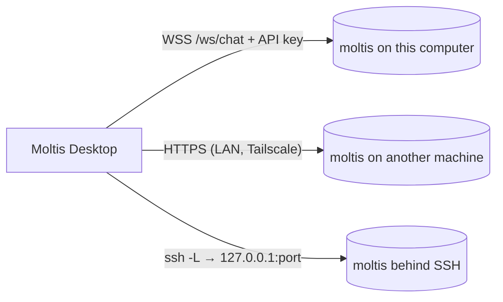

# Desktop App

Moltis Desktop is a native client written in Rust with
[gpui](https://gpui.rs). It **connects to a running moltis daemon** instead of
embedding one: quit the app and the daemon keeps answering your channels, cron
jobs and other clients. It can connect to the daemon on this computer or to
remote daemons.



## Installing

Each release attaches `moltis-desktop-<version>-macos.app.zip`: a universal
(Apple silicon and Intel), signed and notarized app. It **includes the moltis
daemon**, so nothing else needs to be installed: unzip it, move
**Moltis Desktop** to Applications and open it. The first time, the app
installs its daemon as a background service and connects.

For Linux, each release attaches `moltis-desktop-<version>-x86_64.AppImage` and
`moltis-desktop-<version>-aarch64.AppImage`, also with the daemon inside:

```bash
chmod +x moltis-desktop-*.AppImage
./moltis-desktop-*.AppImage
```

It runs on X11 and Wayland and needs a Vulkan driver, `libxkbcommon` and
`fontconfig`, which desktop distributions install by default. An AppImage is
mounted at a new temporary path on every launch, so the app copies its daemon
to `~/.moltis/bin/moltis` and runs the service from there.

## Building it

The app lives in `apps/desktop`, a separate Cargo workspace:

```bash
just desktop-run              # debug build and run (no bundle, no daemon)
just desktop-open-macos       # build the app with its daemon (release), open it
just desktop-package-macos    # only build it, in apps/desktop/target/bundle
just desktop-package-linux    # build the AppImage, in apps/desktop/target/bundle
```

`scripts/package-desktop-macos.sh` builds both binaries and signs them. Its
environment variables choose a universal build (`DESKTOP_UNIVERSAL=1`), the
signing identity (`DESKTOP_SIGN_IDENTITY`), the daemon's features, or no
daemon at all (`DESKTOP_DAEMON=0`); see the script's header.
`scripts/package-desktop-linux.sh` takes the same daemon variables, plus
`DESKTOP_TARGET` and `APPIMAGETOOL`.

On Linux, building needs the development packages of gpui's backends, for
example on Debian or Ubuntu:

```bash
sudo apt-get install libxkbcommon-dev libxkbcommon-x11-dev libwayland-dev \
  libx11-xcb-dev libxcb1-dev libfontconfig-dev libfreetype-dev libvulkan-dev
```

## Connecting

On start the app connects to the last server you used, or to the daemon
configured on this computer (found through `moltis.toml`, honouring
`MOLTIS_CONFIG_DIR`). On a clean installation, **This computer** uses the
default local configuration, and when no daemon answers the app asks **Where
should Moltis run?**:

- **On this computer** installs moltis as a background service and connects
  as soon as it is up.
- **On another computer** opens the **Add a server** form, to connect over
  HTTPS or an SSH tunnel. Nothing is installed locally, so you can use the app
  with a remote daemon only.

Once a service is installed, the app starts it again without asking when it
finds it stopped. It starts the service as installed (`moltis service
restart`), so a daemon you installed with Homebrew or cargo keeps its binary
and options. The app only reinstalls a service that points at a copy of the
app that was moved or deleted. The **Servers** screen (`⌘⇧S`, or click the server name at
the bottom of the sidebar) lists:

- **This computer**: the local daemon, run as a background service
  (`moltis service install`: a launchd agent on macOS, a systemd user unit on
  Linux, or a small supervisor script where systemd is unavailable). It uses
  the `moltis` binary shipped inside the app, or else the one on your `PATH`.
  The service keeps running after the app quits and starts at login;
  `moltis service uninstall` removes it.
  - If you move or delete the app, the service is left pointing at a path
    that no longer exists; the next launch reinstalls it from the app's new
    location. A daemon you installed another way (Homebrew, cargo) is never
    replaced.
  - After an update, the running daemon may be older than the one inside the
    app. A banner offers **Restart daemon**; the app never restarts it
    unasked, since it may be busy.
- **Saved servers**: added by URL (direct HTTPS) or as an SSH tunnel.
- **Nearby**: daemons advertising `_moltis._tcp` over Bonjour/mDNS.

### Direct (HTTPS)

Enter `https://host:port`. Moltis daemons serve a certificate from their own
certificate authority, so the first connection shows the certificate's SHA-256
fingerprint. Compare it with the daemon's before trusting it; the app then
pins it. If the certificate later changes, the app stops and asks again.

Plain `http://` is only accepted for `localhost`: credentials are never sent
unencrypted to another machine.

### SSH tunnel

Enter an SSH destination (`user@host` or an alias from `~/.ssh/config`) and
the daemon's port on that machine. The app runs your system `ssh` (so your
config, agent and hardware keys work as in a terminal) with a local port
forward to the remote loopback address. The daemon does not need to listen on
the network.

If SSH exits during a network outage, the app reopens the tunnel automatically
with retry backoff. **Retry now** also recreates a stopped tunnel.

```admonish note
Before a daemon's first-run setup is complete, connections from its own
loopback address are trusted without credentials. A tunnel lands on that
address, so anyone who can SSH into the machine can use such a daemon.
Finish the setup (set a password) on any daemon you reach over SSH.
```

## Signing in

The first time a daemon asks for credentials, sign in with its password. The
app exchanges it for a scoped API key (`operator.read`, `operator.write`,
`operator.approvals`, never `operator.admin`) labelled
"Moltis Desktop (hostname)", stores the key in the system keychain and forgets
the password. Revoke it any time in the web UI under **Settings → Security**.

Daemons secured only with passkeys: create an API key in the web UI and paste
it into the app.

**File → Sign Out of This Server** deletes the stored key.

## Chatting

- Sessions of the daemon appear in the sidebar, grouped into **Today** and
  **Earlier**; a filled dot marks one that is replying. **New chat** (`⌘N`)
  starts one; **Scheduled** and **Skills** open those pages of the web UI.
- The footer shows the owner's name (from the daemon's user profile) and the
  server; click it to switch servers.
- Replies stream in with native markdown, syntax-highlighted code, collapsible
  reasoning, tool cards (click to see output) and token/speed details.
- After reconnecting, the app reloads the open conversation; other cached
  conversations reload when selected. Live events received while history is
  loading are reconciled with the snapshot.
- The message box keeps your draft until the daemon accepts it. Offline or
  failed submissions retain the text, and edits made while sending are kept.
- Under the message box: the context in use against the model's window
  (`20k / 200k`, from `chat.context`) and the model picker. Stop a reply with
  the stop button or `⌘.`.
- When a command needs approval, an approval card appears above the message
  box. If the window is in the background, a notification is posted; short,
  single-line commands can be approved from it, anything else opens the app
  so you can review the full command.

## Web UI

Settings, channels, providers, scheduled jobs and logs open in your browser
from the **Web** menu (`⌘,` opens settings).

## Protocol

The app speaks the WebSocket RPC protocol v4 through the `moltis-client`
crate, which is also what `moltis-ctl` uses. Typed payloads (chat events,
sessions, models, approvals) are defined in `moltis-protocol` and shared with
the daemon.

## Troubleshooting

- Logs: run with `MOLTIS_DESKTOP_LOG=debug`.
- Screenshots for bug reports: build with `--features capture` and set
  `MOLTIS_DESKTOP_CAPTURE=/path/to/shot.png`.
