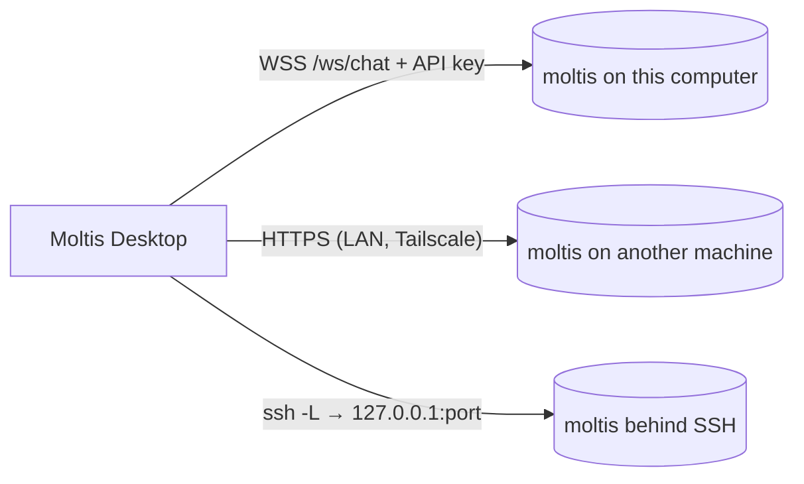

# Desktop App

Moltis Desktop is a native client written in Rust with
[gpui](https://gpui.rs). It **connects to a running moltis daemon** instead of
embedding one: quit the app and the daemon keeps answering your channels, cron
jobs and other clients. It can connect to the daemon on this computer or to
remote daemons.



## Running it

The app lives in `apps/desktop`, a separate Cargo workspace:

```bash
just desktop-run              # debug build and run
just desktop-open-macos       # build the daemon and "Moltis Desktop.app" (release), open it
just desktop-package-macos    # only build the bundle, in apps/desktop/target/bundle
                              # (DESKTOP_DAEMON_BIN=path/to/moltis ships a daemon inside)
```

System notifications (approval prompts) need the app bundle on macOS.

## Connecting

On start the app connects to the last server you used, or to the daemon
configured on this computer (found through `moltis.toml`, honouring
`MOLTIS_CONFIG_DIR`). The **Servers** screen (`⌘⇧S`, or click the server name
at the bottom of the sidebar) lists:

- **This computer**: the local daemon. If it is not running, the app starts
  it as a background service (`moltis service install`, a launchd agent on
  macOS) and connects as soon as it is up. It uses the `moltis` binary shipped
  inside the app, or else the one on your `PATH`. The service keeps running
  after the app quits and starts at login; `moltis service uninstall` removes
  it.
- **Saved servers**: added by URL (direct HTTPS) or as an SSH tunnel.
- **Nearby**: daemons advertising `_moltis._tcp` over Bonjour/mDNS.

### Direct (HTTPS)

Enter `https://host:port`. Moltis daemons serve a certificate from their own
certificate authority, so the first connection shows the certificate's SHA-256
fingerprint. Compare it with the daemon's before trusting it; the app then
pins it. If the certificate later changes, the app stops and asks again.

Plain `http://` is only accepted for `localhost`: credentials are never sent
unencrypted to another machine.

### SSH tunnel

Enter an SSH destination (`user@host` or an alias from `~/.ssh/config`) and
the daemon's port on that machine. The app runs your system `ssh` (so your
config, agent and hardware keys work as in a terminal) with a local port
forward to the remote loopback address. The daemon does not need to listen on
the network.

```admonish note
Before a daemon's first-run setup is complete, connections from its own
loopback address are trusted without credentials. A tunnel lands on that
address, so anyone who can SSH into the machine can use such a daemon.
Finish the setup (set a password) on any daemon you reach over SSH.
```

## Signing in

The first time a daemon asks for credentials, sign in with its password. The
app exchanges it for a scoped API key (`operator.read`, `operator.write`,
`operator.approvals`, never `operator.admin`) labelled
"Moltis Desktop (hostname)", stores the key in the system keychain and forgets
the password. Revoke it any time in the web UI under **Settings → Security**.

Daemons secured only with passkeys: create an API key in the web UI and paste
it into the app.

**File → Sign Out of This Server** deletes the stored key.

## Chatting

- Sessions of the daemon appear in the sidebar, grouped into **Today** and
  **Earlier**; a filled dot marks one that is replying. **New chat** (`⌘N`)
  starts one; **Scheduled** and **Skills** open those pages of the web UI.
- The footer shows the owner's name (from the daemon's user profile) and the
  server; click it to switch servers.
- Replies stream in with native markdown, syntax-highlighted code, collapsible
  reasoning, tool cards (click to see output) and token/speed details.
- Under the message box: the context in use against the model's window
  (`20k / 200k`, from `chat.context`) and the model picker. Stop a reply with
  the stop button or `⌘.`.
- When a command needs approval, an approval card appears above the message
  box. If the window is in the background, a notification is posted; short,
  single-line commands can be approved from it, anything else opens the app
  so you can review the full command.

## Web UI

Settings, channels, providers, scheduled jobs and logs open in your browser
from the **Web** menu (`⌘,` opens settings).

## Protocol

The app speaks the WebSocket RPC protocol v4 through the `moltis-client`
crate, which is also what `moltis-ctl` uses. Typed payloads (chat events,
sessions, models, approvals) are defined in `moltis-protocol` and shared with
the daemon.

## Troubleshooting

- Logs: run with `MOLTIS_DESKTOP_LOG=debug`.
- Screenshots for bug reports: build with `--features capture` and set
  `MOLTIS_DESKTOP_CAPTURE=/path/to/shot.png`.
